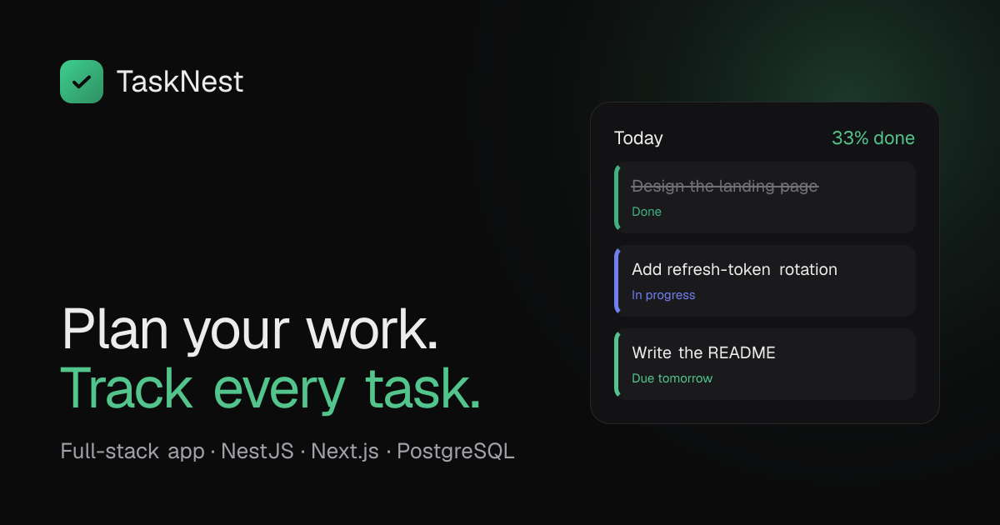
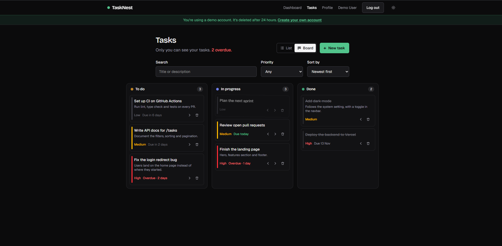
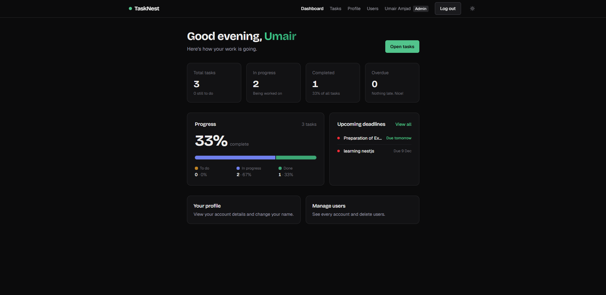
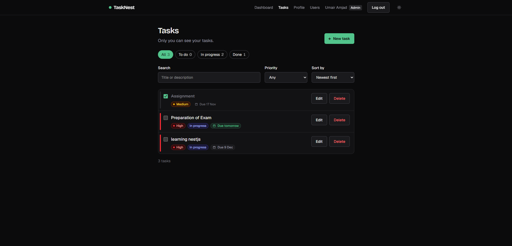
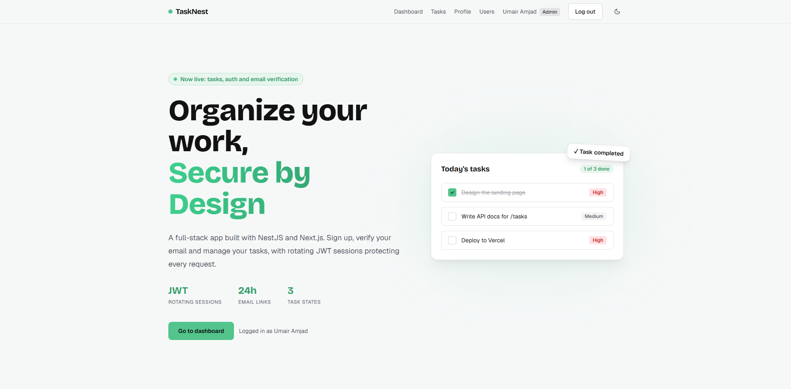
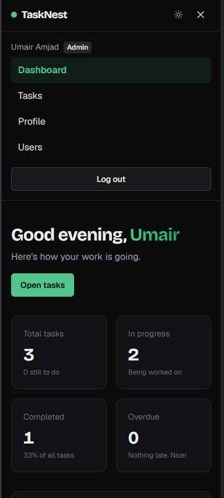

# TaskNest

**Plan your work, track your tasks and keep your account secure.**

A full-stack task manager: a **Next.js 16** frontend (this repo) on top of a **NestJS + Prisma + PostgreSQL** API, with real-world authentication (JWT access and refresh tokens, email verification, password reset and roles).

- 🔗 **Live demo:** https://nest-frontend-apis.vercel.app (click **Try the demo**, no sign-up needed)
- ⚙️ **Backend repo:** https://github.com/umairamjad2/nest-backend-apis



## Screenshots

**Kanban board:** drag cards between columns to change their status



| Dashboard | Tasks |
|---|---|
|  |  |

| Light theme | Mobile |
|---|---|
|  |  |

## Features

**Tasks**
- Create, edit, complete and delete tasks
- List view or a drag-and-drop Kanban board, with arrow buttons on touch screens
- Priority (low, medium, high) and due dates, with labels like "Due tomorrow" and "Overdue · 2 days"
- Search, filter by status or priority, sort, and paginate

**Dashboard**
- Number cards for total, in-progress, completed and overdue tasks
- Progress bar split by status, and a list of upcoming deadlines

**Accounts and security**
- One-click demo: each visitor gets their own temporary account with sample tasks. It's deleted after 24 hours, and demo creation is rate-limited
- Register, verify email, log in, and reset a forgotten password
- The access token is kept only in memory. The refresh token is an `httpOnly` cookie that rotates on every refresh, and parallel 401 responses share one refresh
- Admin role with a user-management page
- Change password from the profile page (other devices get signed out)
- Logged-in devices list: see where you're logged in and sign out any device, or all others at once
- Delete your account, confirmed with your password

**UI**
- Dark and light themes that follow your system setting, with no flash on load
- Responsive layout with a mobile menu
- Toast notifications, empty states and loading skeletons

## Tech stack

| Frontend | Backend |
|---|---|
| Next.js 16 (App Router), React 19, TypeScript | NestJS, TypeScript |
| Tailwind CSS 4 | Prisma ORM + PostgreSQL (Neon) |
| axios (refresh-and-retry interceptor) | JWT + Passport, bcrypt |
| react-hook-form + zod | Nodemailer (SMTP), Helmet, rate limiting |
| Vitest | Swagger / OpenAPI, Vitest |

Both apps are deployed on **Vercel**.

## How it fits together

```
Browser ──► Next.js (Vercel) ──/api/* rewrite──► NestJS API (Vercel) ──► PostgreSQL (Neon)
```

In production the browser only talks to the frontend's own domain. Next.js forwards `/api/*` to the backend, so the refresh-token cookie stays first-party.

## Run it locally

You need Node 24+, pnpm, and the [backend](https://github.com/umairamjad2/nest-backend-apis) running on port 3000.

```bash
pnpm install
```

Create `.env.local`:

```env
NEXT_PUBLIC_API_URL=http://localhost:3000
```

Then:

```bash
pnpm dev        # http://localhost:3001
pnpm test       # unit tests (no backend needed)
pnpm lint
```

The frontend must run on port **3001**, because the backend's CORS allows only that origin.

### Production environment variables (Vercel)

| Variable | Value |
|---|---|
| `NEXT_PUBLIC_API_URL` | `/api` |
| `BACKEND_URL` | the backend's URL, e.g. `https://nest-backend-apis.vercel.app` |
| `NEXT_PUBLIC_SITE_URL` | optional: a custom domain for link-preview images |

## Project structure

```
app/            pages (App Router), icon and link-preview image
components/     UI: navbar, dashboard, tasks, auth forms, ui/ (buttons, toasts, empty states)
content/        editable text: home page and navigation
context/        auth context (session restore, login, logout)
lib/            API client, schemas, task helpers, theme
types/          request and response types for the backend
docs/           build plan and screenshots
```

The original step-by-step build plan and design notes are in [docs/PLAN.md](docs/PLAN.md).
